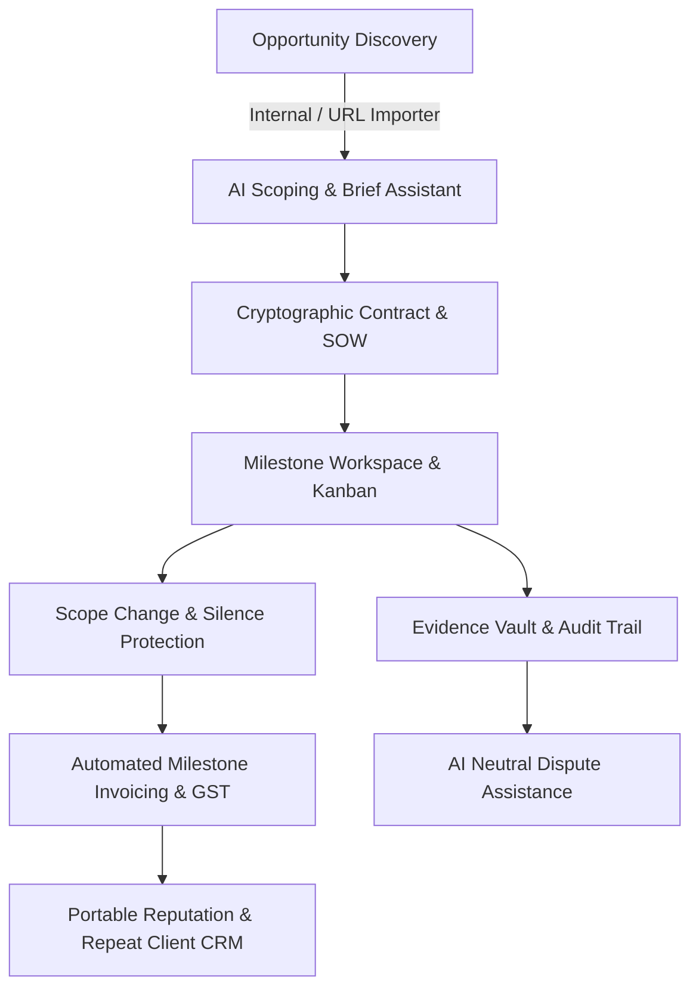

# Bharosa (भरोसा) — Product Architecture, Modular Design & Roadmap

> **AI-Powered Freelance Operating System, Project Management & Trust Platform**  
> *"Trust First Freelance OS: From Opportunity Discovery to Milestone Payout"*

---

## 1. System Vision & Product Architecture

Bharosa is not a traditional bidding marketplace (like Upwork or Fiverr); it is an **all-in-one freelance operating system** built to manage the end-to-end lifecycle of high-trust independent professional relationships.



---

## 2. Platform Modules & Functional Decomposition

Bharosa is organized into **8 core architectural modules**:

### Module 1: AI Scoping, Brief Generator & Document Engine
- **Natural Language SOW Generation:** Turns ambiguous client prompts (e.g. *"I need 12 Instagram reels, each under 30 seconds, delivered over three weeks. Budget ₹18,000."*) into structured milestone deliverables, timeline estimates, and risk flags.
- **Contract Clauses & Jurisdiction Review:** Auto-populates clauses for IP assignment upon full payment, client review turnaround windows (e.g., 48–72 hours), and cancellation kill fees.
- **Strict Human-in-the-Loop:** AI drafts are never self-executing; both parties must sign before binding execution.

### Module 2: Universal Opportunity Finder & URL Importer
- **Internal Curated Feed:** Skill-weighted job recommendations with match explanations.
- **External URL Opportunity Importer:** Freelancers paste job listings from LinkedIn, Upwork, Twitter/X, or direct client job boards.
  - Automatically extracts job scope, budget, and deadlines.
  - Drafts custom proposals matched against the freelancer's actual portfolio.
  - Creates a dedicated Bharosa Workspace to protect payment and execution, even if the lead originated elsewhere.

### Module 3: Unique Freelancer Protection Suite
- **Client Silence Protection:** If a client fails to provide required feedback or approvals within the contractual window (e.g., 72 hours), the platform halts penalty clocks, records the delay, and calculates a fair timeline extension (+N days).
- **Revision Fairness Meter:** Quantifies agreed revisions (e.g., 2 rounds included). Analyzes incoming feedback and classifies requests into *Corrections*, *Included Revisions*, or *Scope Change Amendments*.
- **Scope Change Detector:** Flags new requirements (e.g., requesting 3D Spline assets when 2D vector was contracted) and pre-calculates price and deadline adjustments for mutual sign-off before work begins.
- **Project Readiness Check:** Enforces checklist completion (assets, brand guidelines, credentials, initial advance/escrow) before work status changes to "Active".

### Module 4: Project Management Workspace & Deliverable Hub
- **Multi-View Project Board:** Kanban board (Agreed Scope, In Progress & Review, Approved & Completed), Gantt milestone timeline, and file repository.
- **Asset Versioning:** Connects exact design iterations and feedback pins directly to contractual deliverables.
- **Decision-Maker Authority:** Distinguishes team commentary from binding approval authorizations.

### Module 5: Cryptographic Evidence Vault & Dispute Assistant
- **Tamper-Evident Audit Log:** Every contract clause, approval click, delivered asset hash (SHA-256), and silence event is recorded chronologically.
- **AI Dispute Organizer:** In case of a disagreement, AI assembles the contract baseline, submissions, revision count, and communications, presenting a neutral, transparent summary with compromise proposals rather than making arbitrary binding rulings.

### Module 6: Invoicing, Financial Management & GST Compliance
- **Milestone-Triggered Invoicing:** Invoices generate automatically upon milestone sign-off.
- **Indian & Global Compliance:** Standardized GST (18%) itemization, reverse charge handling, and export invoices.
- **Protected Escrow & Payout Integrations:** Milestone fund locking via regulated payment providers (e.g. Razorpay, Stripe Connect).

### Module 7: Branded Client Portals
- **White-Labeled Client Interface:** Dedicated client URL showcasing milestones, asset approvals, invoice payment links, and video meeting schedules without marketplace noise.
- **Permission Boundaries:** Clients can only view their specific project data and cannot access internal team notes or other client records.

### Module 8: Agency & Multi-Member Workspaces
- **Role-Based Access Control (RBAC):** Freelancers, Agency Project Managers, Designers, Client Stakeholders, and Platform Admins.
- **Resource & Capacity Planning:** Team availability tracking, cross-project utilization, and agency revenue share.

---

## 3. Core User Journeys

### User Journey 1: Freelancer Discovers & Scopes a Project
1. **Import:** Freelancer copies a lead URL from LinkedIn and clicks **"Import Job by URL"** in Bharosa.
2. **AI Analysis:** Bharosa extracts deliverables, highlights missing information (e.g., source file format), and drafts a tailored pitch proposal.
3. **SOW Generation:** Once the client accepts, the AI Project Assistant structures the chat into 3 milestones with clear revision limits.
4. **Sign-off:** Both parties e-sign the agreement, and Milestone 1 escrow is funded.

### User Journey 2: Scope Creep Prevention & Revision Tracking
1. **Submission:** Freelancer delivers Milestone 2 (Mobile App Prototypes).
2. **Client Feedback:** Client says *"Can you also add an interactive 3D WebGL animation and 5 extra screens?"*
3. **Detection:** Bharosa's **Revision Fairness Meter** flags the request as exceeding the agreed 2D scope.
4. **Resolution:** AI drafts a **Scope Change Amendment** for ₹6,500 and +2 days. The client approves with 1 click, updating the contract budget without awkward confrontation.

### User Journey 3: Client Silence & Payment Release
1. **Submission:** Freelancer submits final video batch for review.
2. **Inactivity:** Client does not respond for 4 consecutive days.
3. **Silence Protocol:** Bharosa sends a reminder, logs the inactivity in the **Evidence Vault**, and suspends the delivery deadline countdown.
4. **Resolution:** Client returns, acknowledges delay, and releases payment without penalty deductions.

---

## 4. UI/UX Information Architecture & Screens

```
├── Authentication & Onboarding
│   ├── Role Selection (Freelancer / Client / Agency)
│   ├── Quick Demo Persona Switcher
│   └── Profile Onboarding & Preference Setup
├── Main Application Shell
│   ├── Topbar (Global Search, Active Role Mode, Dark/Light Theme Switcher, User Avatar)
│   └── Collapsible Sidebar Navigation
├── Screen 1: Dashboard Overview
│   ├── 4 Stat Metric Cards (Active Projects, Monthly Earnings ₹, Pending Payouts, Fairness Index)
│   ├── Client Silence Alert Banner
│   ├── Revision Fairness Meter Widget
│   └── Active Project Pipeline Table
├── Screen 2: AI Project Assistant & Scoper
│   ├── Natural Language Prompt Input & Preset Chips
│   ├── Real-time Structured SOW (Deliverables, Milestones, Payment Split)
│   └── 1-Click Agreement Conversion
├── Screen 3: Job Opportunity Finder & URL Importer
│   ├── Skill-based Search & Category Filter Pills
│   ├── Match Score Indicators
│   └── External URL Import Modal (Upwork / LinkedIn parser)
├── Screen 4: Project Workspace & Kanban
│   ├── 3-Column Kanban (Scope & Backlog, In Progress & Review, Approved & Completed)
│   ├── Deliverable Inspection & Revision Counter
│   └── "+ Add Deliverable" Action
├── Screen 5: Evidence Vault & Dispute Assistant
│   ├── SHA-256 Verified Timeline Logs
│   ├── Revision Quota Breakdown Bar
│   └── AI Neutral Dispute Resolution Assistant Modal
├── Screen 6: Invoicing & Payment Records
│   ├── Milestone Invoices Table with GST Itemization
│   └── "+ Create Milestone Invoice" Modal
└── Screen 7: Branded Client Portal
    └── White-Labeled Client Preview Hub with Escrow Status
```

---

## 5. Implementation Roadmap

| Phase | Duration | Core Deliverables |
|---|---|---|
| **Phase 1: Foundation (Completed)** | Week 1–2 | • Modern Design System with seamless **Light & Dark Theme** toggle.<br>• Interactive Dashboard with 3 Persona logins (Freelancer, Client, Agency).<br>• AI Project Scoper & Natural Language Brief Converter.<br>• External Opportunity URL Importer.<br>• Client Silence & Revision Fairness alert engines.<br>• Milestone Invoicing with GST support. |
| **Phase 2: Deep Integrations** | Week 3–6 | • WebSockets for real-time Kanban and in-app chat.<br>• WebRTC / Daily.co / LiveKit for integrated video meetings with live AI meeting minutes.<br>• E-signature integration (Aadhaar e-Sign / DocuSign API).<br>• Cloud file storage (S3/GCS) with chunked upload and PDF invoice generation. |
| **Phase 3: Regulated Escrow & Payments** | Week 7–10 | • Payment Gateway Integration (Razorpay Route / Stripe Connect Custom Accounts).<br>• Automated Milestone Escrow hold & release triggers.<br>• Multi-currency support (INR, USD, EUR, GBP) and foreign inward remittance documentation. |
| **Phase 4: Ecosystem & Mobile** | Week 11–14 | • Native mobile apps (React Native / Flutter).<br>• Chrome Extension for 1-click job importing directly from LinkedIn, Upwork, and Twitter feeds.<br>• Public Portable Reputation Profile URLs (`bharosa.id/@priya`). |

---

## 6. How to Run the Bharosa Application Locally

```bash
# Option 1: Built-in Node Server (Zero dependencies)
node server.js
# Access at http://localhost:3000

# Option 2: Using NPM Scripts
cmd.exe /c npm run dev

# Option 3: Direct File Access
# Open index.html in any modern browser (Chrome, Edge, Firefox, Safari)
```
