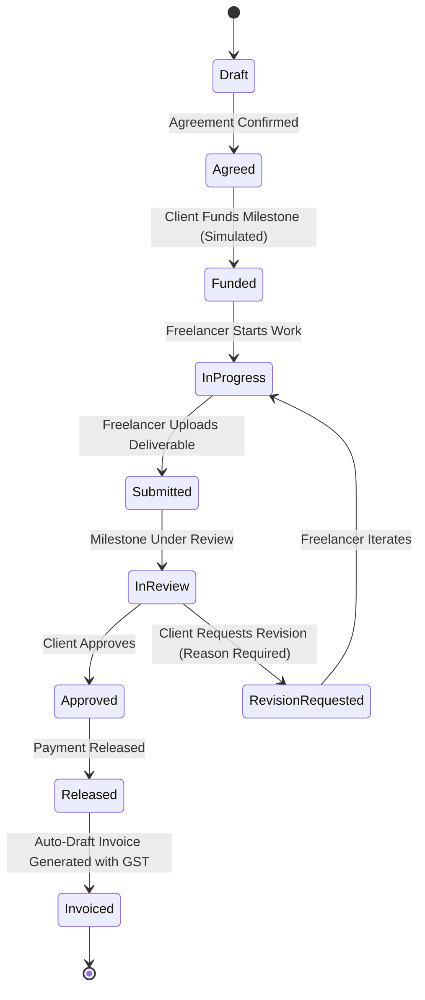

# Bharosa OS

> **Trust, project-protection, and milestone-payment platform for freelancers and clients.**
> Deployed at: [https://bharosa-os.vercel.app](https://bharosa-os.vercel.app)

---

## 1. Roles, Permissions & Data Segregation

Bharosa OS enforces strict server-side permissions and role segregation across all endpoints and UI views. The "Active View" switch and Agency Mode have been completely removed in favor of separate, dedicated role workspaces.

### User Roles
| Role | Identity & Purpose | Permitted Routes | Forbidden Access |
| :--- | :--- | :--- | :--- |
| **`freelancer`** | Creator executing project milestones and deliverables. | `/freelancer/*`, `/projects/:id` | Blocked from `/client/*` and `/admin` (HTTP 403) |
| **`client`** | Project commissioner funding milestones and approving deliverables. | `/client/*`, `/projects/:id` | Blocked from `/freelancer/*` and `/admin` (HTTP 403) |
| **`admin`** | Super administrator overseeing platform integrity, disputes, and compliance. | `/admin`, `/projects/:id`, `/freelancer/*`, `/client/*` | Unrestricted audit authority |

### Server-Enforced Data Protection
- **No Freelancer Earnings Exposure**: A client fetching project details via `/api/projects` or `/api/projects/:id` receives sanitized models where freelancer earnings, hourly rates, and private notes (`freelancerPrivateNotes`) are strictly stripped on the server.
- **Cross-Role HTTP 403**: Any API request by a client targeting `/api/freelancer/*` or by a freelancer targeting `/api/client/*` is rejected with `HTTP 403 Forbidden`.
- **UI Route Guards**: Attempting to navigate directly to an unauthorized route triggers an immediate redirection to the dedicated `/403` page.

---

## 2. Route Architecture

```
/ (Home / Login)             ──> Dedicated "Demo login" cards for Freelancer, Client, and Admin
├── /freelancer/dashboard     ──> Freelancer Command Center (Deliverables, Action items, Earnings, Invoices)
├── /client/dashboard         ──> Client Command Center (Project tracking, Approvals, Budget vs Spent)
├── /projects/:id             ──> Shared Project Workspace (Overview, Milestones, Deliverables, Invoices, Timeline)
├── /admin                    ──> Super Admin Control Panel (Dispute queue, Platform metrics, User audits)
└── /403                      ──> Role-based Access Forbidden notification
```

---

## 3. Milestone Workflow & State Machine

Each milestone follows an append-only, transition-checked state machine:



### Transition Authority Rules
1. **Approval**: ONLY the client (`client` role) can approve deliverables and release funds. Freelancer attempts return `HTTP 403 Forbidden`.
2. **Deliverable Submission**: ONLY the assigned freelancer (`freelancer` role) can submit deliverables and trigger review status.
3. **Audit Trail**: Every status transition automatically records `actorId`, `actorRole`, `timestamp`, `reason`, and `evidenceHash` into the append-only audit log.
4. **Revision Quota**: Every project defines an agreed revision limit (e.g. 2 revisions). Revisions requested beyond the quota are automatically flagged as a **Possible Scope Change**. Either party can clarify or agree to an amendment.
5. **Scope Change Amendments**:
   - The freelancer drafts an amendment specifying extra cost and required time.
   - The contract budget and schedule update **ONLY after explicit client approval**.
6. **Client Silence Protection**:
   - Triggered when client review exceeds the agreed window (**72 hours** from config).
   - Sending a reminder **requires proposing a new schedule**. Deadlines are never silently auto-extended.
7. **Invoicing & GST**:
   - Approving a milestone automatically generates a draft invoice.
   - Domestic transactions calculate standard GST (18%).
   - SEZ / Cross-border transactions are classified as **Zero-Rated Export** (not "exempt").
8. **Simulated Payments**:
   - Demonstrations use simulated payment gateway providers (e.g. Razorpay Sandbox).
   - The platform never claims to hold escrow or banking deposits.

---

## 4. Seed Accounts (Demo Login)

| Role | Name | Email | Password / Action |
| :--- | :--- | :--- | :--- |
| **Freelancer** | Priya Sharma | `priya@bharosa.design` | Click "Demo login as Freelancer" |
| **Client** | Rahul Verma | `rahul@growthnest.media` | Click "Demo login as Client" |
| **Super Admin** | Platform Moderator | `admin@bharosa.design` | Click "Demo login as Admin" |

---

## 5. Running the Test Suite

```bash
# Run server-side API & state machine tests
node test-server-api.js

# Run full end-to-end acceptance checks
node test-e2e.js
```
